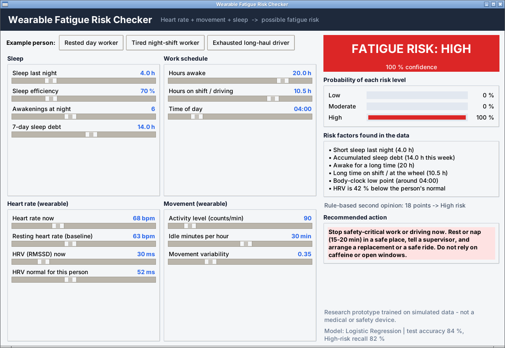
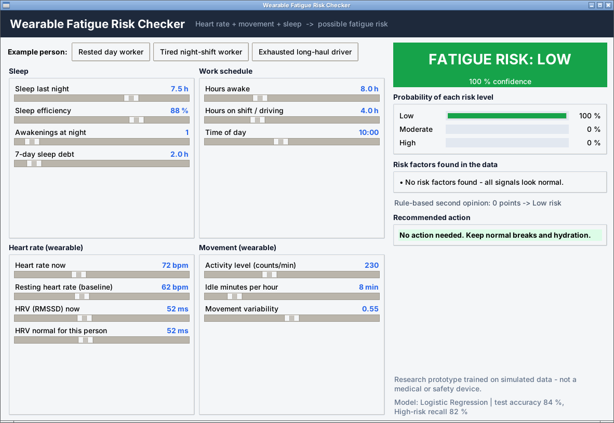
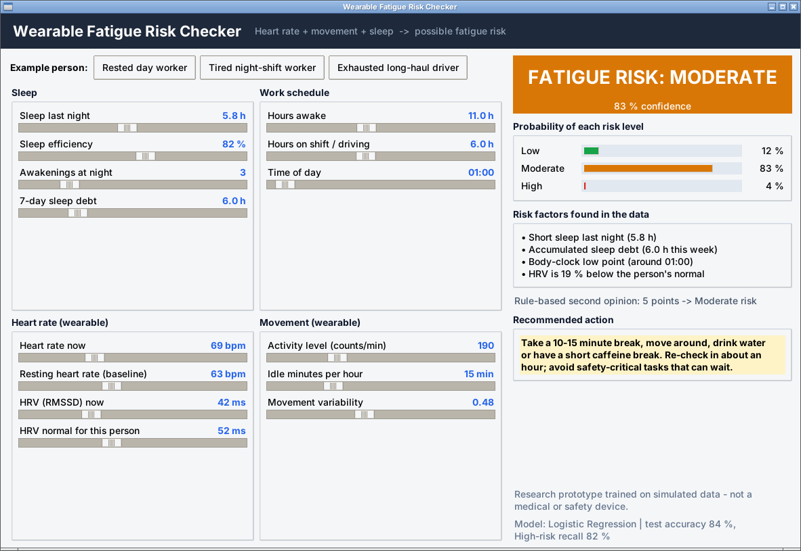

# Wearable Technology: Fatigue and Drowsiness Risk Detection

A machine-learning prototype that identifies **possible fatigue risk** (Low / Moderate / High) from
**heart rate (HRV), movement and sleep-related data**, combined with the work schedule.
**Use case:** workplace safety and driver-fatigue research.

> **Read this first.** No real wearable recordings were available, so the dataset is **simulated**.
> The results show that the pipeline works end to end, **not** how accurate it would be on real people.
> This is a research prototype for decision support. It is **not** a medical or safety device and must
> never be the only safety barrier in a workplace or a vehicle.



---

## Table of contents
1. [Features](#features)
2. [Screenshots](#screenshots)
3. [Quick start](#quick-start)
4. [Project structure](#project-structure)
5. [How it works](#how-it-works)
6. [Results](#results)
7. [Using real data](#using-real-data)
8. [Limitations](#limitations)
9. [Ethics and responsible use](#ethics-and-responsible-use)
10. [Future work](#future-work)
11. [Tech stack](#tech-stack)
12. [Author](#author)

---

## Features
- **Desktop app (tkinter):** 14 sliders for sleep, work schedule, heart rate/HRV and movement. The result updates live.
- **Risk level with probabilities** for Low, Moderate and High.
- **Explanations:** the risk factors found in the data (for example "Short sleep last night (4.0 h)").
- **Second opinion:** an explainable rule-based score is shown next to the ML prediction.
- **Recommended action** for each risk level (continue, take a break, stop safety-critical work).
- **Input sanity checks** (for example, hours on shift cannot exceed hours awake).
- **Three example people** (rested day worker, tired night-shift worker, exhausted long-haul driver).
- **Self-healing model loading:** if the saved model does not match your scikit-learn version, the app re-trains in a few seconds.
- **Complete experiment:** data generator, person-wise evaluation, 4-model comparison, signal-group study, figures, executed notebook and a one-page report.

## Screenshots
| Low risk | Moderate risk | High risk |
|---|---|---|
|  |  |  |

## Quick start
**Requirements:** Python 3.9 or newer (tested on 3.12). tkinter ships with Python on Windows and macOS.
On Linux install it with `sudo apt install python3-tk`.

```bash
pip install -r requirements.txt
python src/fatigue_app.py
```

Everything needed is included (dataset, trained model, results). To rebuild from scratch:

```bash
python src/generate_data.py      # 1. create data/wearable_fatigue_data.csv
python src/train_model.py        # 2. train, evaluate, save model, figures and tables
python src/fatigue_app.py        # 3. start the desktop app
```

To open the analysis, run Jupyter (or VS Code) and open `fatigue_risk_analysis.ipynb`. It is already executed, so the outputs are visible without running anything.

## Project structure
```
Wearable_Fatigue_Risk_Detection/
|-- README.md
|-- requirements.txt
|-- Fatigue_Risk_Report.pdf          one-page report
|-- fatigue_risk_analysis.ipynb      full analysis with outputs
|-- src/
|   |-- fatigue_core.py              features, circadian curve, rule-based score, advice
|   |-- generate_data.py             simulated wearable dataset generator
|   |-- train_model.py               training, person-wise evaluation, figures
|   `-- fatigue_app.py               desktop GUI
|-- data/wearable_fatigue_data.csv   6,000 simulated monitoring windows
|-- models/                          saved model (.joblib) and model_info.json
|-- results/                         metric tables, classification report, figures/
`-- screenshots/                     app screenshots
```

## How it works

### 1. Data (simulated)
One row is one **monitoring window** of one person, like a short summary from a smart-watch plus the shift roster.
The dataset has **150 people x 40 windows = 6,000 rows**, with day (50 %), evening (20 %) and night (30 %) shift workers.

How the simulation works:
1. Each person gets personal baselines (resting heart rate, normal HRV), a usual sleep length, a shift type and a personal sensitivity to fatigue.
2. Sleep and schedule signals are drawn for each window (night workers sleep less and stay awake longer).
3. A **hidden fatigue score** is computed from sleep, sleep debt, hours awake, time on shift and the body-clock low points, plus noise.
4. The body signals react to that hidden score (HRV falls, heart rate rises, activity drops, idle time grows) with a lot of noise, as real sensors are noisy.
5. The label is cut from the hidden score. The models never see it, only the wearable signals.

Class balance: Low 59 %, Moderate 28 %, High 13 %. High risk is concentrated in night work (35 % of night windows vs about 4-5 % of day and evening windows).

**Raw columns**

| Group | Column | Meaning |
|---|---|---|
| Sleep | `sleep_hours` | hours slept last night |
| | `sleep_efficiency` | % of time in bed actually asleep |
| | `awakenings` | awakenings last night |
| | `sleep_debt_7d` | hours of missing sleep over 7 nights (vs 7.5 h) |
| Schedule | `hours_awake` | hours since waking up |
| | `shift_hours` | hours already worked or driven |
| | `hour_of_day` | clock hour 0-23 |
| Heart | `hr_mean`, `hr_resting` | heart rate in the window and personal resting baseline (bpm) |
| | `hrv_rmssd`, `hrv_baseline` | HRV in the window and the person's normal (ms) |
| Movement | `activity_level` | mean activity counts per minute |
| | `idle_min_per_hr` | minutes per hour with almost no movement |
| | `movement_var` | variability of movement intensity (0-1) |
| Other | `subject_id`, `shift_type`, `fatigue_risk` | person id, shift type, label |

### 2. Features (13 used by the models)
The raw signals plus three engineered ones:
- `circadian_risk`: a body-clock curve with a main low point around 03:00-05:00 and a smaller dip around 14:00-16:00.
- `hr_delta`: heart rate above the person's own resting rate.
- `hrv_ratio`: HRV compared with the person's own normal.

Baseline-relative features matter because "normal" differs a lot between people.

### 3. Models
| Model | Role |
|---|---|
| Rule-based score | Explainable baseline: points for short sleep, sleep debt, long wakefulness, long shifts, body-clock low point, low HRV and low movement. 0-4 points = Low, 5-8 = Moderate, 9+ = High. |
| Logistic Regression | Chosen model (standardised inputs, balanced class weights) |
| Random Forest | Comparison |
| Gradient Boosting | Comparison |

### 4. Evaluation
- The split is **by person**: 112 people (4,480 windows) for training and 38 different people (1,520 windows) for testing. Nobody appears in both, so the test score shows how the model behaves for **new people**.
- The best model is chosen by **5-fold grouped cross-validation on the training people only**; the test people are used once.
- Metrics: accuracy, macro-F1 and especially **recall of the High class**, because missing a fatigued person is the costly error in safety work.

## Results
Scores on the 38 unseen test people:

| Model | CV macro-F1 | Accuracy | Macro-F1 | Recall of High | Precision of High |
|---|---|---|---|---|---|
| Rule-based score (baseline) | - | 0.814 | 0.752 | 0.579 | 0.864 |
| **Logistic Regression (chosen)** | 0.799 | 0.837 | 0.796 | **0.817** | 0.759 |
| Random Forest | 0.793 | 0.846 | 0.794 | 0.721 | 0.807 |
| Gradient Boosting | 0.787 | 0.843 | 0.791 | 0.726 | 0.822 |

The three ML models are very close (0.79-0.80 macro-F1), so the simple and explainable Logistic Regression was kept. Its main gain over the rule baseline is finding **82 % of High-risk windows instead of 58 %**.

Per class (Logistic Regression): Low F1 0.91, Moderate F1 0.69, High F1 0.79. Moderate is the hardest class because it sits between the other two.

**Which signals carry the information?** Same model, different inputs:

| Inputs | Accuracy | Macro-F1 | Recall of High |
|---|---|---|---|
| Heart rate + HRV only | 0.522 | 0.437 | 0.675 |
| Movement only | 0.673 | 0.616 | 0.706 |
| Heart + movement (body signals) | 0.686 | 0.628 | 0.716 |
| Sleep only | 0.776 | 0.714 | 0.721 |
| Sleep + schedule | 0.824 | 0.780 | 0.802 |
| **All signals** | 0.837 | 0.796 | 0.817 |

On this simulated data, sleep and schedule carry most of the information, heart rate/HRV alone is weak and movement is moderate. This depends on how the simulation lets the body signals react, so it must be re-measured on real recordings. Combining several sources is still the sensible design.

Figures are in `results/figures/`: `confusion_matrices.png`, `model_comparison.png`, `feature_importance.png`, `signal_groups.png`.

## Using real data
1. Prepare a CSV with the same columns as `data/wearable_fatigue_data.csv` (see the table above), including `subject_id` and the `fatigue_risk` label (`Low`, `Moderate` or `High`).
2. Replace `data/wearable_fatigue_data.csv` with it.
3. Run `python src/train_model.py`.

For labels use a trusted reference, for example a reaction-time test (PVT), expert ratings or validated sleepiness scales, not a guess from the same sensor signals.

## Limitations
- **Simulated data:** real-world accuracy is unknown.
- **Circularity:** the labels come from a model of fatigue, not from measured drowsiness, so the ML model partly learns the simulator's rules.
- **Individual differences:** fatigue varies from person to person. Baseline-relative features help, but real use needs per-person calibration.
- **Window level only:** each window is scored independently. There is no time-series model and no direct drowsiness cues such as blinks or head position.
- **Not validated** against any clinical or safety standard.

## Ethics and responsible use
- Workers' physiological data is sensitive. Real use needs informed consent, data minimisation and clear retention rules.
- Output should **support** safety measures (rest rules, supervisors, safe replacements) and must not be used for discipline or surveillance.
- A false "Low" can give false reassurance and a false "High" can cause unnecessary stops. Both errors need human review.

## Future work
- Validate on real wearable data with a reference such as PVT.
- Per-person calibration and time-series models (sequences of windows).
- Add more signals (skin temperature, respiration, steering or lane data for drivers).
- Probability calibration and alert thresholds tuned for recall of High.
- Live connection to a wearable or phone app.

## Tech stack
Python, NumPy, pandas, scikit-learn, matplotlib, joblib, tkinter, Jupyter.

## Author
👨‍💻 Developer
Muhammad Anas Murtaza

GitHub: https://github.com/anasmurtaza

Linkedin: https://www.linkedin.com/in/m-anas-murtaza
